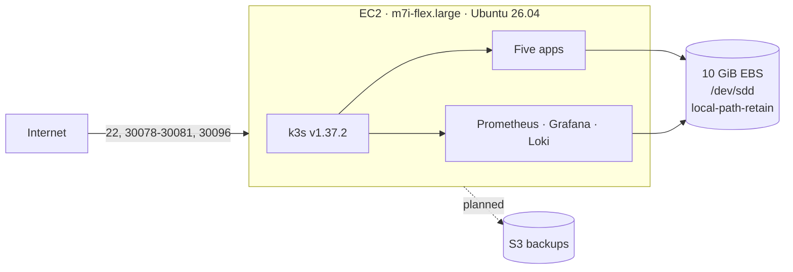

# cloud-native-homelab

A small, self-hosted cloud platform on AWS: one EC2 node, k3s, Helm, a retained EBS data
volume, Infrastructure as Code, and a full observability stack.

The point of this project is not the apps. It is the full lifecycle: design, provision, deploy,
secure, observe, and document — with the trade-offs written down instead of hidden.

## Status

| Layer | State |
|---|---|
| AWS | E2C ... |
| Kubernetes | k3s `v1.37.2`, single node |
| Apps | Five running: Jellyfin, Nextcloud, Navidrome, n8n, Open WebUI |
| Observability | Prometheus, Alertmanager, Grafana, Loki, Promtail — 14/14 targets UP |
| IaC | Terraform (partial): instance, data volume, security group |
| Automation | `cloud-init` node bootstrap + `helmfile` for all releases |
| GitOps | Planned (ArgoCD) |

The instance is running now. Terraform state is still local; the S3 backend, IAM role, backups,
and alarms are the next hardening step.

## What runs

| App | URL | Storage | Notes |
|---|---|---|---|
| Jellyfin | `http://<public-ip>:30096` | Media streaming |
| Nextcloud | `http://<public-ip>:30080` |  SQLite, cron CronJob |
| Navidrome | `http://<public-ip>:30081` |  Music streaming |
| n8n | `http://<public-ip>:30079` |  Workflow automation |
| Open WebUI | `http://<public-ip>:30078` | First registered user becomes admin |

Observability is **internal only**: Grafana, Prometheus, Alertmanager, and Loki are
`ClusterIP` services reached through an SSH tunnel. No extra public port.

## Architecture



The data volume is a separate gp3 volume mounted at `/var/lib/rancher/k3s/storage`. It survives
instance replacement; the root volume does not.

## Stack

| Layer | Choice | Why |
|---|---|---|
| Cloud | AWS, `eu-north-1` | Cost-constrained, one region |
| Compute | 1 × `m7i-flex.large`, 8 GB | Fits k3s, five apps, and observability |
| Orchestration | k3s | Full Kubernetes without a control-plane fee |
| Ingress | Traefik (bundled) | One HTTP entry point; no Ingress objects yet |
| Storage | `local-path-retain` on EBS | POSIX for databases and app data |
| Packaging | Helm + helmfile | Pinned upstream charts, one deploy command |
| Node bootstrap | cloud-init | Mounts the data volume, installs k3s + Helm + helmfile |
| IaC | Terraform | Reproducible AWS layer; local state today |
| Metrics / logs | Prometheus, Loki, Promtail | Standard, low-footprint stack |

## Repository layout

```
bootstrap/cloud-init.yaml   mounts the data volume, installs k3s, Helm, helmfile
terraform/                  AWS layer: instance, EBS volume, security group
helmfile.yaml               all eight Helm releases, pinned versions
scripts/deploy.sh           copies manifests to the node, creates secrets, runs helmfile
k8s/                        everything that runs inside the cluster
  namespaces/               one namespace per app
  platform/                 StorageClass
  apps/<app>/               values.yaml + README per app
  observability/            kube-prometheus-stack, Loki, Promtail
```

Each `k8s/apps/<app>/README.md` documents that app's install and verification steps.
`terraform/README.md` covers the AWS layer.

## Quick start

Prerequisites: Terraform ≥ 1.10, AWS CLI with an `AWS_PROFILE`, and the SSH private key.

```bash
export AWS_PROFILE=homelab
export AWS_REGION=eu-north-1

# 1. AWS resources
cd terraform
terraform init
terraform plan
terraform apply

# 2. Node bootstrap + all apps + observability
cd ..
./scripts/deploy.sh
```

The AMI, subnet, and key-pair IDs are pinned to this AWS account and region. Change them in
`terraform/variables.tf` before using the stack elsewhere.

`deploy.sh`:

1. waits for SSH and `cloud-init`;
2. copies `k8s/` and `helmfile.yaml` to the node;
3. generates or reuses the Nextcloud and Grafana passwords in `~/cnh-secrets/`;
4. creates the `grafana-admin` Secret;
5. runs `helmfile sync` for all eight releases;
6. applies the n8n NodePort Service and the Loki datasource ConfigMap.

It is idempotent: run it again after any change.

### Secrets

Nothing secret is committed. Passwords live in `~/cnh-secrets/` (mode 700/600) and on the node
only inside Kubernetes Secrets.

| Secret | Location |
|---|---|
| Nextcloud admin password | `~/cnh-secrets/nextcloud-admin-password.txt` |
| Grafana admin password | `~/cnh-secrets/grafana-admin.txt` |
| n8n encryption key | Kubernetes Secret `n8n-encryption-key-secret-v2` |
| SSH private key | local only; override with `CNH_KEY=/path/to/key` |

Back up `~/cnh-secrets/` off-machine. Rebuilding without the n8n encryption key makes previously
stored n8n credentials unreadable.

## Operations

```bash
ssh -i <key.pem> ubuntu@<public-ip>
sudo k3s kubectl get nodes
sudo k3s kubectl get pods -A
sudo helm --kubeconfig /etc/rancher/k3s/k3s.yaml list -A
```

Grafana (internal only):

```bash
GRAFANA_IP=$(ssh -i <key.pem> ubuntu@<public-ip> \
  "sudo k3s kubectl -n observability get svc kube-prometheus-stack-grafana -o jsonpath='{.spec.clusterIP}'")
ssh -i <key.pem> -L 3000:$GRAFANA_IP:80 ubuntu@<public-ip>
# http://localhost:3000
```

Prometheus `:9090`, Alertmanager `:9093`, and Loki `:3100` follow the same pattern.


## License

Personal project. No license granted.
